<div align="center">


# 📦 Painel de Cargas

**Controle online das cargas de envio para o Mercado Livre: da roteirização à entrega.**

Site com login e perfis de acesso, onde a equipe toda acompanha as mesmas cargas em tempo real.

[](https://painel-cargas-canais-digitais.netlify.app/)


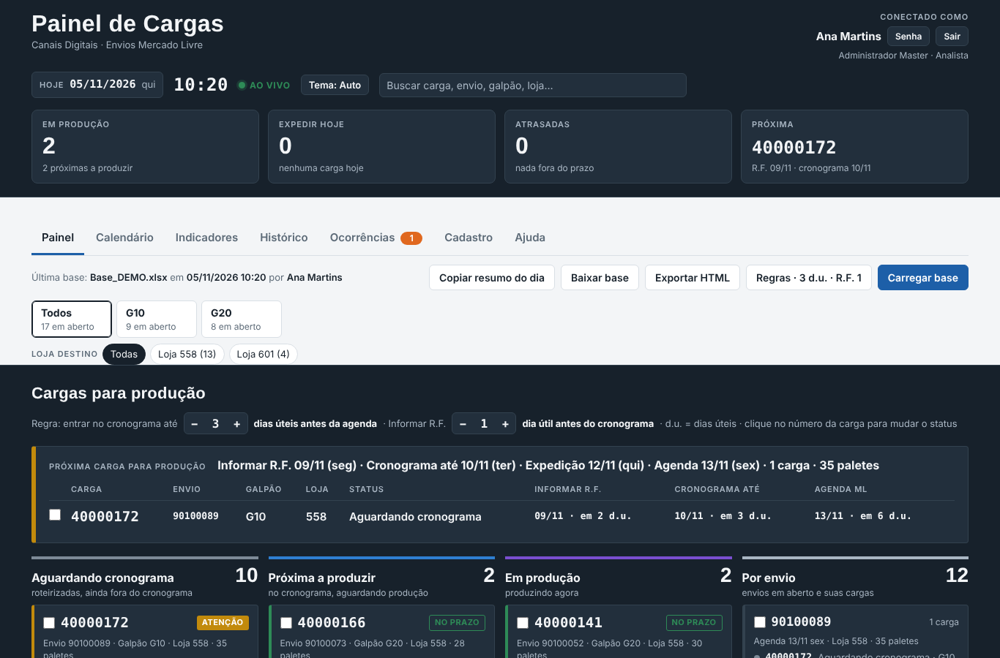

</div>

---

## 📊 Sobre o projeto

O **Painel de Cargas** nasceu da necessidade de acompanhar, em um só lugar, as cargas que estão em produção e as que ainda vão ser produzidas para envio ao **Mercado Livre**.

Antes, o controle era feito direto na planilha, sem uma visão clara de **qual carga acompanhar primeiro** e **em que etapa cada uma estava**. O projeto começou como um arquivo HTML que lia a planilha, virou um aplicativo instalável e hoje é um **site online** com banco de dados, login, perfis, ocorrências, histórico de alterações e e-mails automáticos.

A regra acordada com a operação é aplicada sozinha:

> 🗓️ **A carga entra no cronograma 3 dias úteis antes da agenda**, o **R.F. é informado 1 dia útil antes do cronograma** e a **expedição é na véspera da agenda** (a entrega no Mercado Livre é na madrugada do dia agendado).

---

## ✨ Funcionalidades

| | Funcionalidade | O que faz |
|---|---|---|
| 🔐 | **Login e criação de conta** | Usuário e senha; conta nova só com o **código do time**; "esqueci minha senha" por e-mail |
| 👥 | **Perfis e permissões** | **Master**, **Administrador**, **Operador**, **Visualizador** e **Personalizado**, com matriz de permissões editável, bloquear e excluir conta; tudo conferido no próprio banco (RLS e gatilhos) |
| ⚡ | **Tempo real** | O que uma pessoa muda aparece na hora para todo mundo ("Ao vivo") |
| 🏭 | **Cargas para produção** | Próximas cargas, colunas por etapa e visão por envio |
| 📊 | **Cartões do topo** | Em produção, expedir hoje, atrasadas e próxima carga, clicáveis |
| 🔎 | **Busca** | Carga, envio, galpão ou loja, em todas as abas |
| 🧮 | **Datas automáticas** | Cronograma, R.F. e expedição em dias úteis, sem fins de semana e feriados |
| 🚨 | **Alertas** | Fora do prazo, informar R.F. hoje, incluir hoje, expedir hoje, risco de atraso |
| 🗓️ | **Calendário** | Semana e mês por galpão, com as **cargas conjugadas** (mesmo envio) destacadas |
| 📈 | **Indicadores** | % no prazo do cronograma, % entregue na agenda, tempo por etapa, **OTIF de expedição** (6 meses), **motivos de atraso** e relatório do mês |
| 💬 | **Comentários e motivo do atraso** | Recados da equipe em cada carga, em tempo real, e motivo informado nas cargas atrasadas |
| 📺 | **Modo TV** | Tela cheia para monitor da operação, alternando Resumo e Agendadas |
| 📥 | **Importação do WMS** | Lê o relatório do Infor WMS (abas Data e Detail): cria as cargas, avança a produção, traz unidades e os **detalhes da carga** (itens por SKU, corte e paletes arredondados para cima), conferindo os totais e os dois formatos de número |
| 🏷️ | **Base de SKUs** | Código e descrição dos itens, atualizável a qualquer momento; a busca encontra cargas pelo SKU |
| 📅 | **Agendar envio** | Um envio do Mercado Livre com uma ou mais cargas: agenda, prazos calculados na hora, juntar, reagendar ou tirar carga do envio |
| 🟦 | **PBR e CHEP** | Informados quando a carga fica pronta, em lote, conferidos com os paletes do WMS |
| ⚠️ | **Ocorrências** | Registro e resolução de problemas por carga, com autor e data |
| 🕓 | **Histórico** | Toda alteração com data, hora e quem fez, gravada pelo banco (não dá para editar) |
| 🗂️ | **Cadastro** | Equipes, funções, perfis, lojas, galpões, tipos de ocorrência e código do time |
| ✉️ | **E-mails automáticos** | Resumo do dia, relatório semanal de uso, **relatório mensal** (dia 1) e **alertas imediatos** de carga atrasada e nova ocorrência |
| ✅ | **R.F. informado** | Marca na carga (ou em lote) quem informou o R.F. e quando; o alerta sai |
| 📅 | **Regra da terça** | Agenda na terça: R.F. na sexta anterior e cronograma até o sábado da produção |
| 📦 | **Paletes PBR** | Saldo de PBR enviados e não devolvidos, retornos, previsão com as cargas agendadas e alerta perto do limite (só o Administrador Master) |
| 💬 | **Mensagens prontas** | Textos para WhatsApp e Teams: informar R.F., avisar expedição e reagendamento |
| 🧩 | **Pendências de cadastro** | Cargas em aberto sem envio, agenda, galpão, loja, paletes ou PBR e CHEP |
| 🟢 | **Quem está online** | Iniciais de quem está com o painel aberto |
| 🟦 | **Microsoft Teams** | Resumo do dia e alertas de paletes num canal, via Workflows |
| 💾 | **Backup semanal** | A base inteira em Excel anexada ao relatório semanal |
| 🛡️ | **Segurança** | Bloqueio após 5 senhas erradas, senha mínima de 8, CSP e cabeçalhos de segurança, leitura só para quem tem perfil |
| 📱 | **Celular** | Abas fixas embaixo e cartões compactos |
| 🛰️ | **Visual "torre de controle"** | Página de entrada animada, painéis de vidro escuro e o fluxo das cargas animado |
| 🗄️ | **Arquivamento** | Cargas encerradas saem do painel após 60 dias e são apagadas após 12 meses |
| 🌗 | **Tema** | Auto, escuro ou claro |
| ❓ | **Ajuda** | Guia dentro do próprio site, de acordo com o perfil |

---

## 🖼️ Prints

### 🔐 Entrar ou criar conta
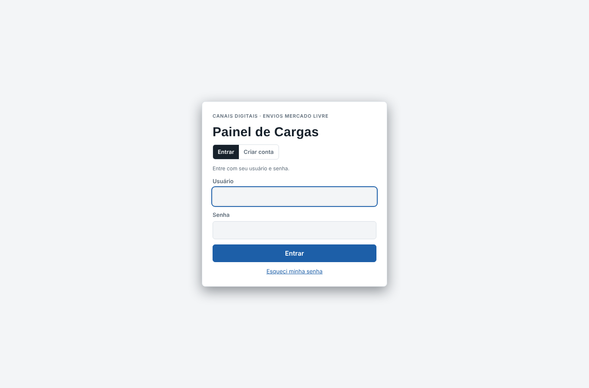

### ⚠️ Ocorrências
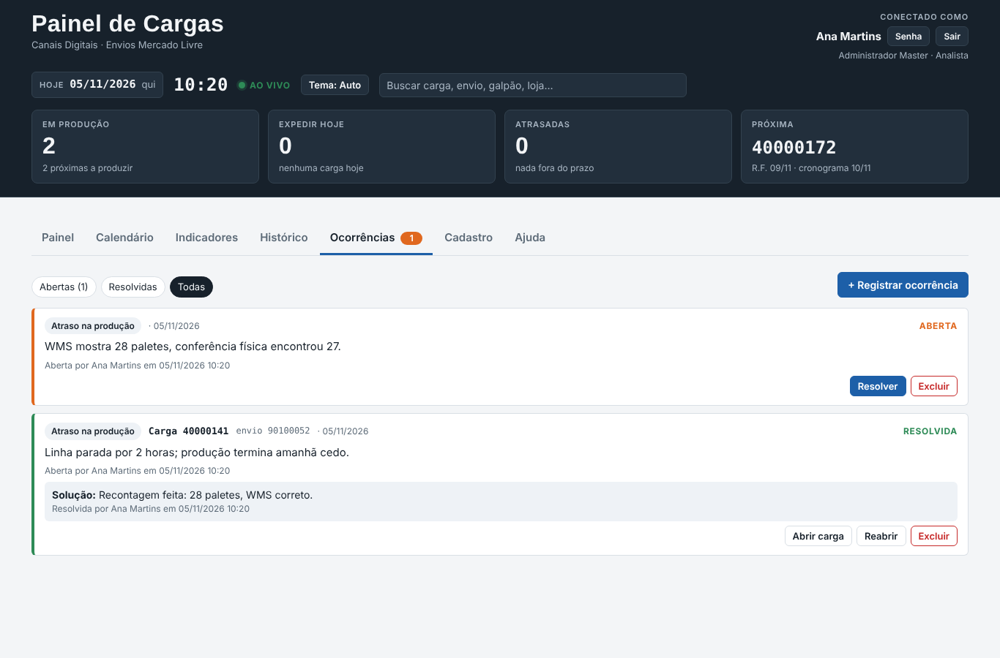

### 🕓 Histórico de alterações
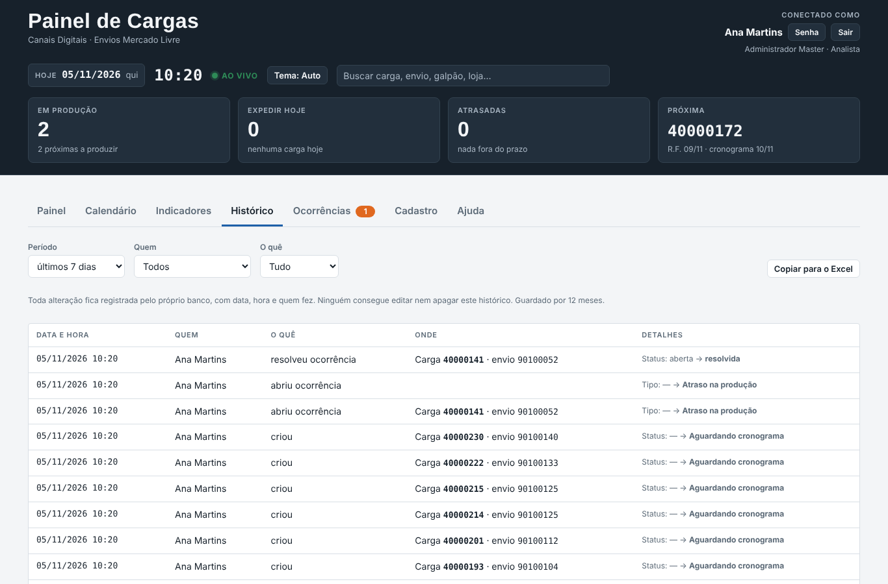

### 🗂️ Cadastro (Administrador Master)
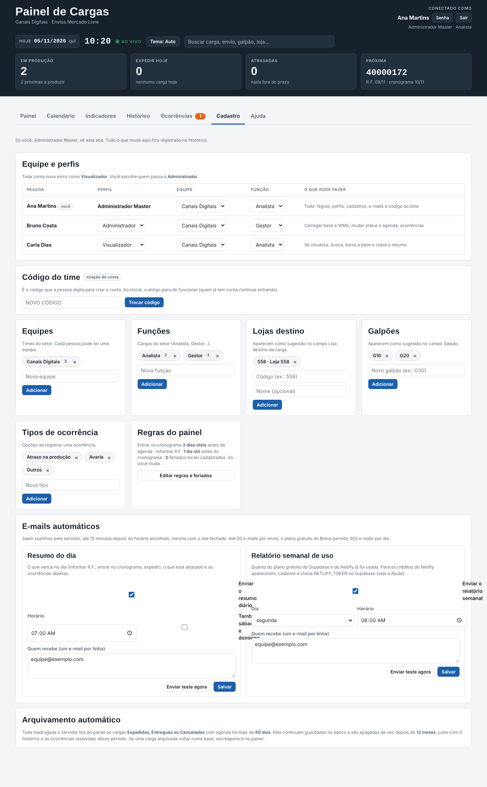

### 🗓️ Calendário com as cargas conjugadas
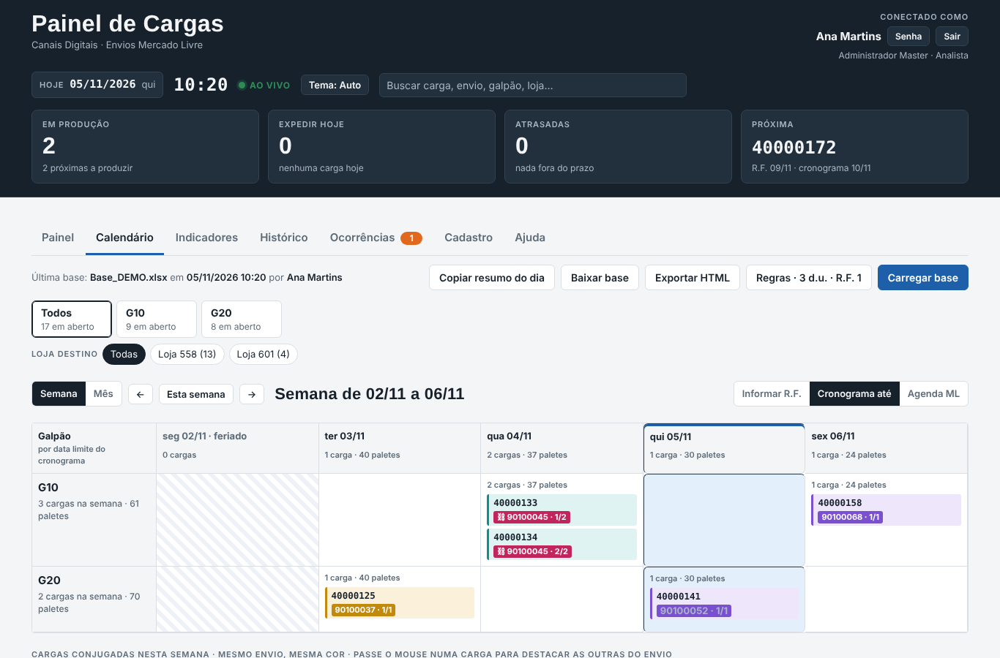

### 📈 Indicadores
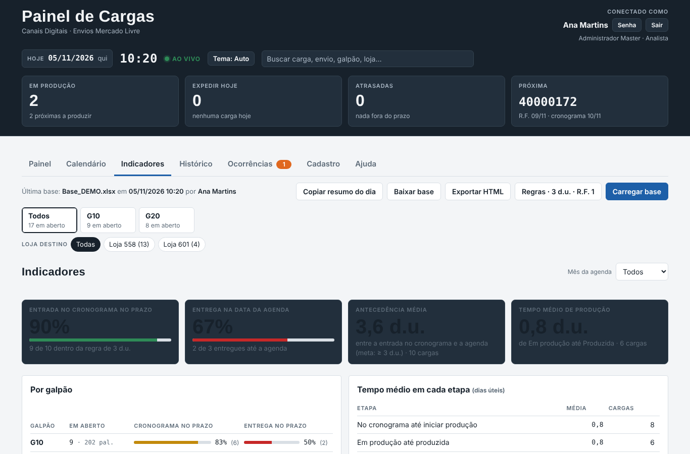

### 🔎 Busca por envio
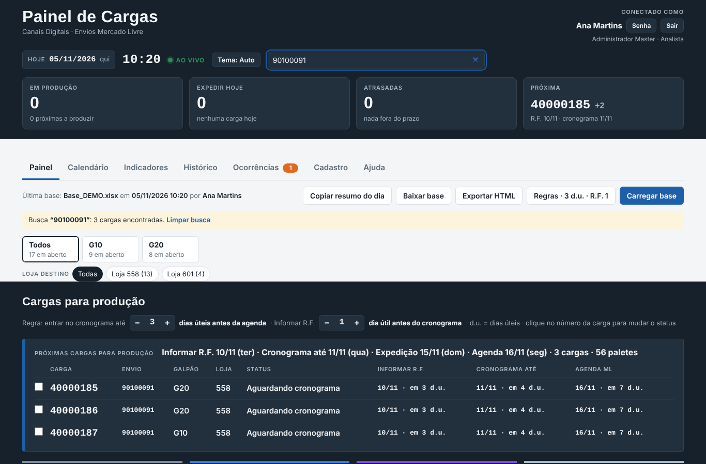

### ☀️ Tema claro
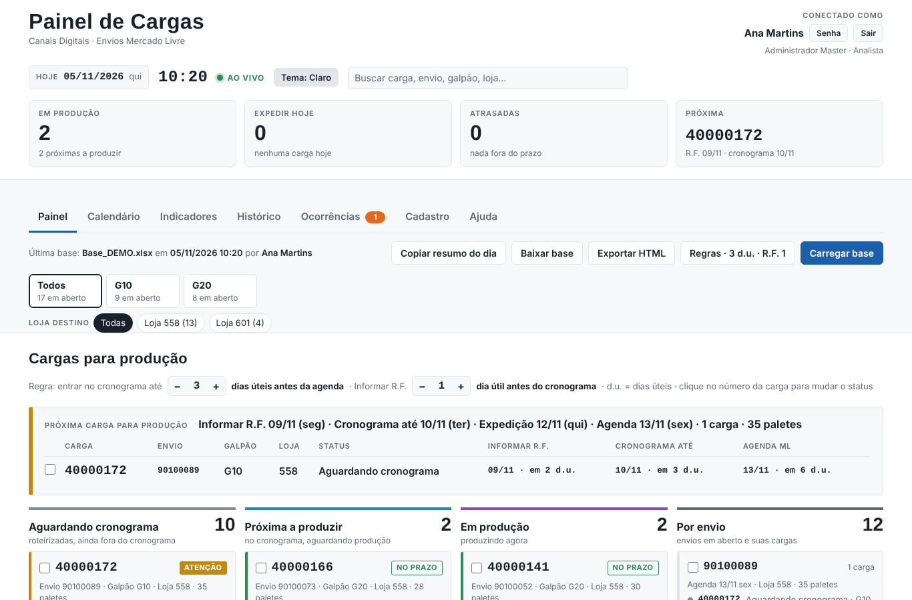

<table>
<tr>
<td width="62%"><b>✏️ Detalhes da carga, ocorrências e histórico</b><br><br>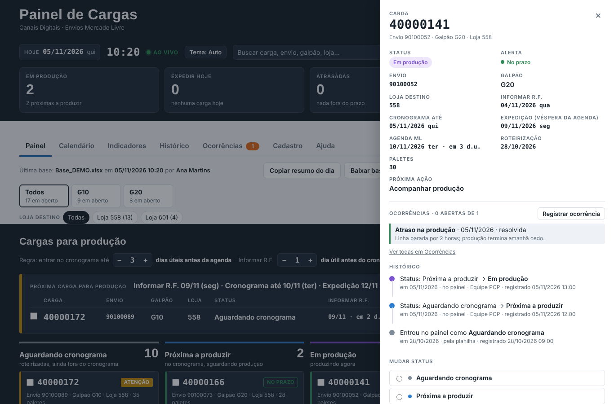</td>
<td width="38%" align="center"><b>📱 No celular</b><br><br>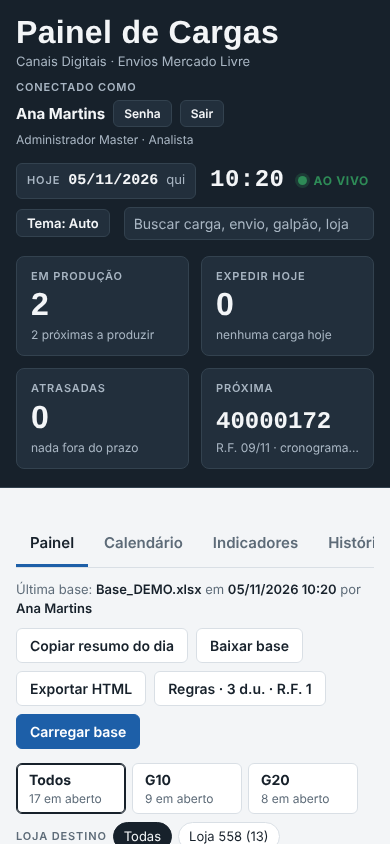</td>
</tr>
</table>

### ❓ Ajuda
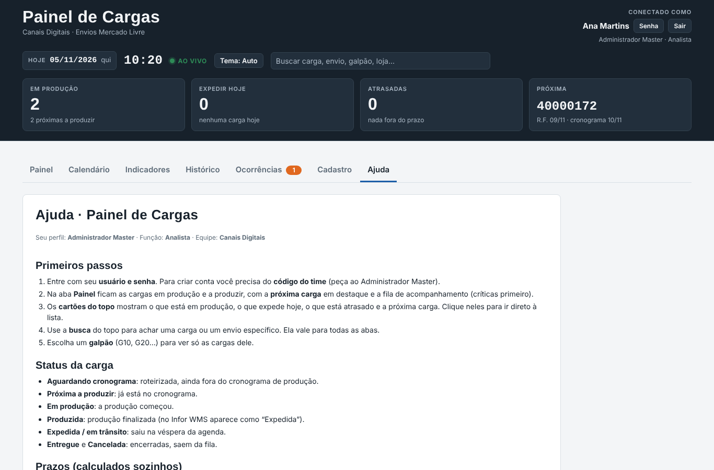

> ℹ️ Os prints usam uma **base de demonstração com números e nomes fictícios**.

---

## 🏗️ Arquitetura

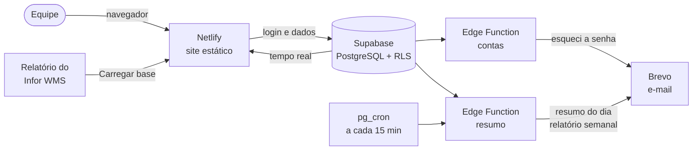

| Camada | Como funciona |
|---|---|
| 🌐 **Site** | Uma página HTML/CSS/JS sem frameworks, publicada no Netlify. O leitor de Excel só carrega quando alguém importa uma planilha |
| 🗄️ **Banco** | PostgreSQL no Supabase. Tabelas `cargas`, `ocorrencias`, `historico`, `perfis`, `cargas_config` |
| 🛡️ **Segurança** | Row Level Security: Visualizador só lê, Administrador altera cargas e ocorrências, só o Master muda regras, perfis e cadastros |
| 🕓 **Histórico** | Gatilhos (triggers) gravam cada alteração com autor e horário definidos pelo servidor |
| ✉️ **E-mails** | `pg_cron` confere a cada 15 minutos o horário configurado no site e chama a função `resumo`, que monta o e-mail e envia pelo Brevo |
| 🧹 **Manutenção** | Rotina diária arquiva cargas encerradas após 60 dias e apaga dados com mais de 12 meses |

Tudo roda dentro dos **planos gratuitos** do Supabase, Netlify e Brevo.

---

## 🔄 Fluxo da carga

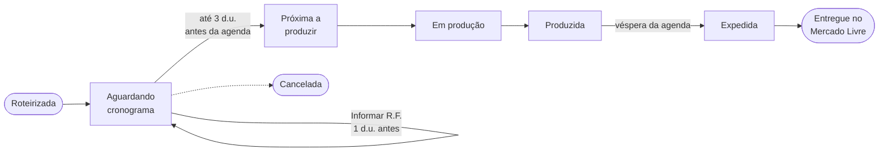

| Data | Como é calculada |
|---|---|
| 📌 **Cronograma até** | Data de agenda − **3 dias úteis** |
| 📝 **Informar R.F.** | Data do cronograma − **1 dia útil** |
| 🚚 **Expedição** | Véspera da agenda |
| 🗓️ **Agenda ML** | Data de entrega no Mercado Livre (portal ML) |

*Dias úteis consideram fins de semana, feriados nacionais e feriados locais cadastrados.*

---

## 👥 Perfis

| Perfil | Pode |
|---|---|
| 👑 **Administrador Master** | Tudo: regras, perfis, cadastros, e-mails automáticos e código do time |
| 🛠️ **Administrador** | Carregar base e WMS, mudar status e agenda, registrar e resolver ocorrências |
| 👀 **Visualizador** | Ver, buscar, baixar a base e copiar o resumo (padrão de toda conta nova) |

---

## 📄 Planilha base

| Coluna | Descrição |
|---|---|
| `#ENVIO` | Número do envio (pode ter uma ou mais cargas) |
| `CARGA` | Número da carga roteirizada |
| `GALPÃO` | Galpão onde a carga é produzida |
| `LOJA DESTINO` | Loja para onde a carga vai |
| `DATA ROTEIRIZAÇÃO` | Data em que a carga foi criada |
| `DATA AGENDA` | Data de entrega no Mercado Livre |
| `STATUS` | Aguardando cronograma · Próxima a produzir · Em produção · Produzida · Expedida · Entregue · Cancelada |
| `PALETES` | Estimativa de paletes (vem do WMS) |
| `OBSERVAÇÃO` | Livre |

Exemplo com dados fictícios em [`exemplo/Base_DEMO.xlsx`](exemplo/Base_DEMO.xlsx).

---

## 🛠️ Tecnologias utilizadas

- **HTML5, CSS3 e JavaScript**, sem frameworks
- **[Supabase](https://supabase.com/)**: PostgreSQL, autenticação, Row Level Security, Realtime, Edge Functions (Deno/TypeScript), `pg_cron` e `pg_net`
- **[Netlify](https://www.netlify.com/)** para hospedar o site
- **[Brevo](https://www.brevo.com/)** para os e-mails (senha, resumo do dia, relatório semanal)
- **[SheetJS](https://sheetjs.com/)** para ler e gerar Excel no próprio navegador
- **Excel** com fórmulas `DIATRABALHO` (`WORKDAY`) na planilha base

---

## 🧱 Estrutura do projeto

```
painel-cargas/
├── site/                       → site publicado no Netlify (gerado por src/build_site.py)
├── src/
│   ├── painel-cargas.html      → painel: interface, regras de prazo, calendário, indicadores, importação
│   ├── online.js               → login, dados no Supabase, tempo real, Histórico, Ocorrências e Cadastro
│   └── build_site.py           → monta o site a partir dos dois arquivos acima
├── supabase/
│   ├── schema.sql              → tabelas, segurança (RLS), gatilhos do histórico e rotinas automáticas
│   └── functions/
│       ├── contas/index.ts     → entrar, criar conta, esqueci a senha, código do time
│       └── resumo/index.ts     → resumo do dia e relatório semanal por e-mail
├── arquivo/Painel_de_Cargas.html → versão em arquivo único, que roda offline no navegador
├── exemplo/Base_DEMO.xlsx      → planilha base com dados fictícios
├── imgs/                       → prints deste README
└── index.html, sw.js           → aviso do app instalável antigo (aposentado)
```

---

## 🧭 Evolução

1. **Arquivo HTML** que lia a planilha da equipe
2. **Aplicativo instalável (PWA)** no GitHub Pages, funcionando offline
3. **Site online** com Supabase e Netlify: login, perfis, tempo real, ocorrências, histórico, cadastro e e-mails automáticos
4. **v3**: controle de paletes PBR, R.F. informado, regra da terça, mensagens prontas, Teams, backup semanal, reforço de segurança e visual novo

---

## 🔒 Dados e privacidade

Este repositório guarda **somente o código**. Os dados das cargas ficam no banco do Supabase, protegidos por login e pelas regras de acesso; nenhum dado real está no GitHub. A chave que aparece no site é a chave pública do Supabase, feita para ficar no navegador: o que protege os dados são as regras de segurança do banco.

---

## 📌 Status do projeto

✅ **Em uso** pelo time de Planejamento, Canais Digitais
🚧 **Em evolução**, com novas melhorias conforme a operação

---

<div align="center">

Desenvolvido por **[Allan](https://github.com/Allan056)** · com apoio de Inteligência Artificial

</div>
