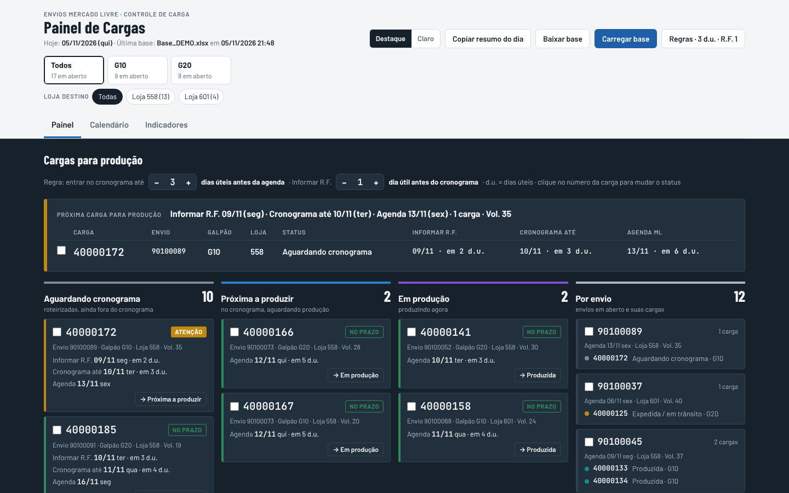
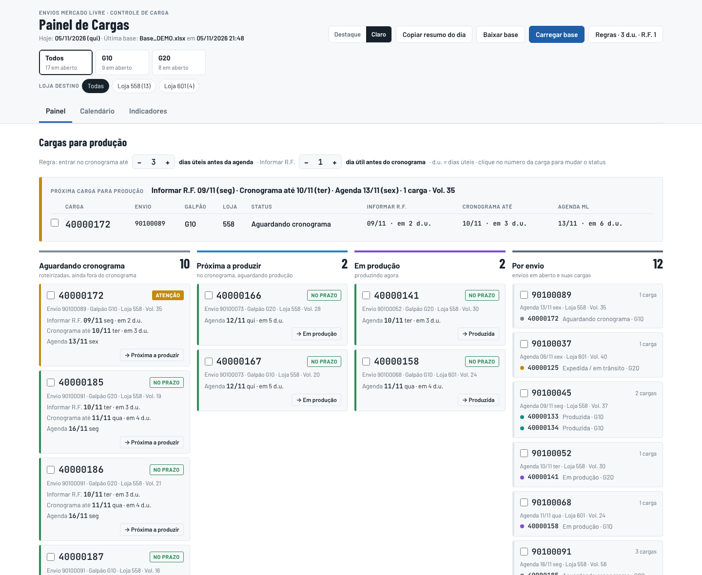
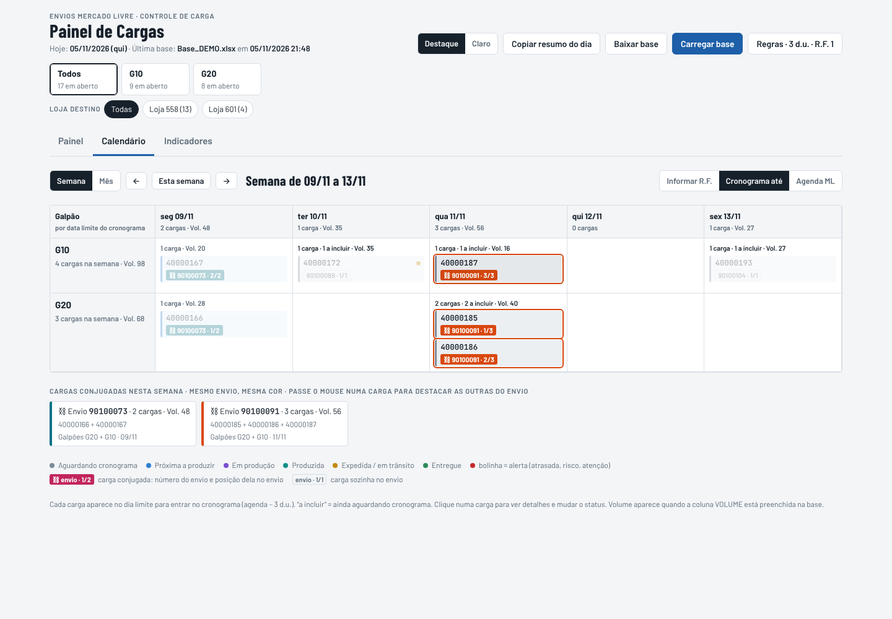
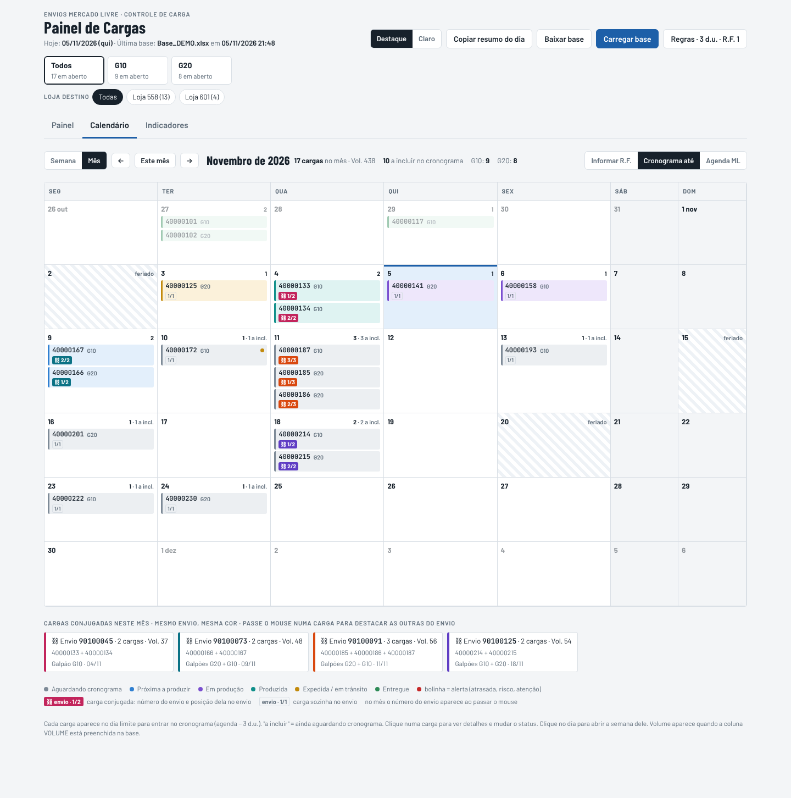
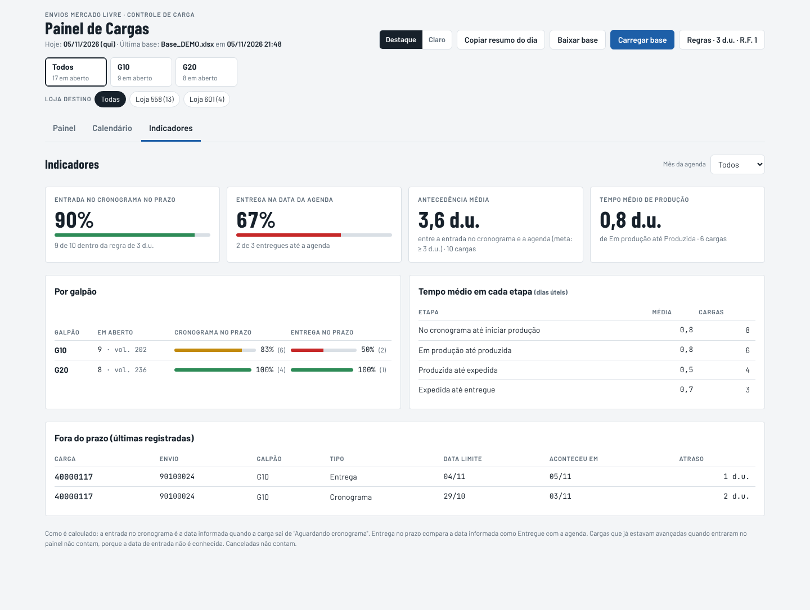
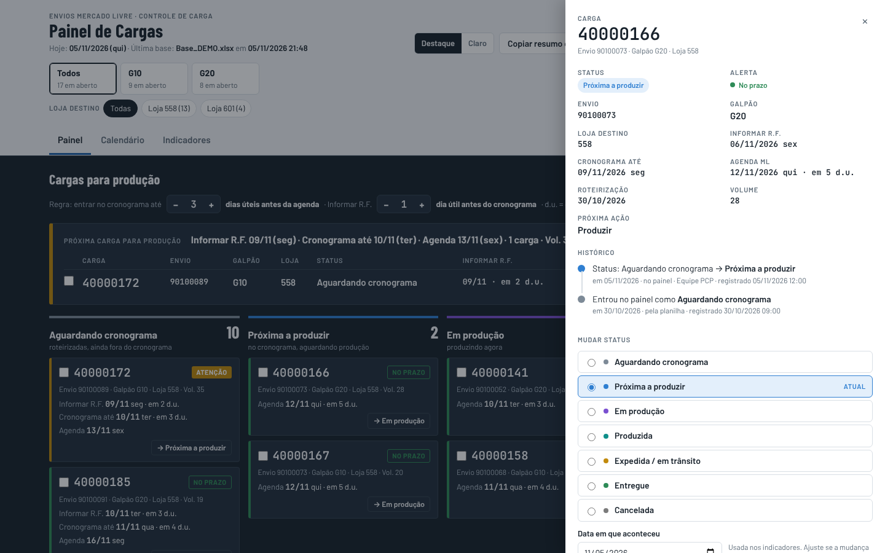
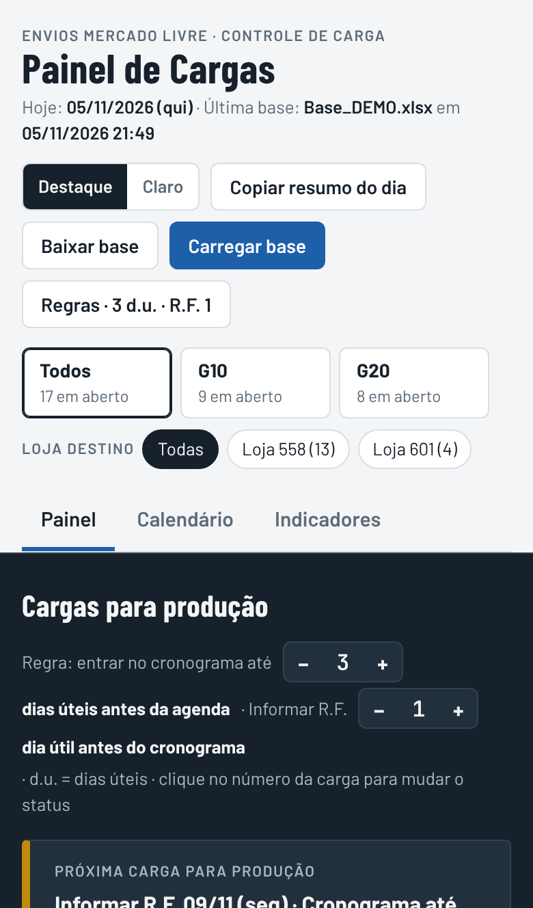
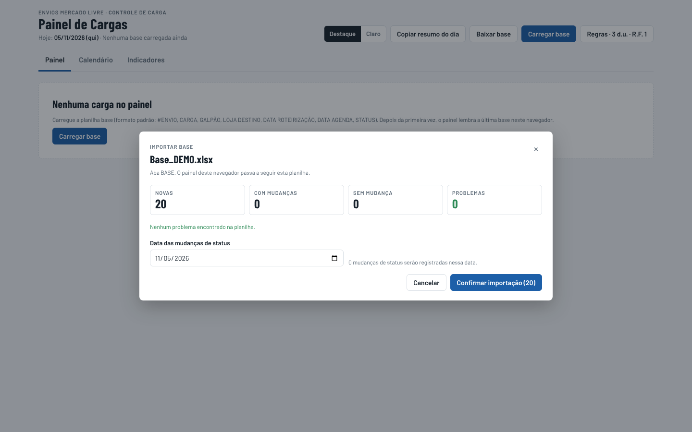
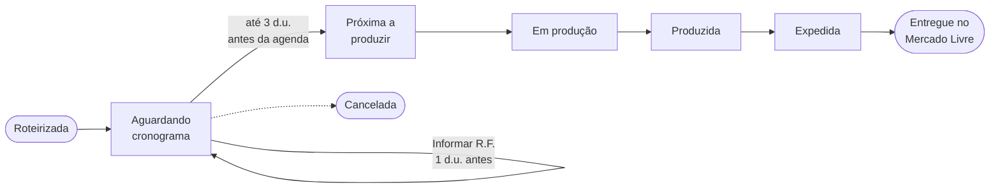

<div align="center">


# 📦 Painel de Cargas

**Controle das cargas de envio para o Mercado Livre: da roteirização à entrega.**

Aplicativo instalável no computador e no celular, que funciona sem internet e lê a planilha base da equipe.

[](https://allan056.github.io/painel-cargas/)




</div>

---

## 📊 Sobre o projeto

O **Painel de Cargas** nasceu da necessidade de acompanhar, em um só lugar, as cargas que estão em produção e as que ainda vão ser produzidas para envio ao **Mercado Livre**.

Antes, o controle era feito direto na planilha, sem uma visão clara de **qual carga acompanhar primeiro** e **em que etapa cada uma estava**. O painel lê a planilha base e mostra isso na hora, aplicando automaticamente a regra acordada com a operação:

> 🗓️ **A carga deve entrar no cronograma 3 dias úteis antes da data de agenda**, e o **R.F. deve ser informado 1 dia útil antes do cronograma**.

---

## ✨ Funcionalidades

| | Funcionalidade | O que faz |
|---|---|---|
| 🏭 | **Cargas para produção** | Próximas cargas do dia, colunas por etapa e visão por envio |
| 🧮 | **Datas automáticas** | Calcula *Cronograma* e *Informar R.F.* em dias úteis, sem fins de semana e feriados |
| 🚨 | **Alertas** | Fora do prazo, incluir hoje, informar R.F. hoje, risco de atraso, entrega atrasada |
| ✏️ | **Status no painel** | Muda o status de uma carga (ou de várias) com data e histórico |
| 🗓️ | **Calendário** | Visão semanal e mensal por galpão, com as **cargas conjugadas** destacadas |
| 📈 | **Indicadores** | % no prazo do cronograma, % entregue na agenda e tempo médio por etapa |
| 🔎 | **Filtros e busca** | Por galpão, loja destino, status, carga ou envio |
| ✅ | **Conferência da base** | Ao carregar a planilha, mostra problemas e o que vai mudar antes de gravar |
| 📤 | **Exportação para Excel** | Cargas selecionadas ou a base completa, com histórico e regras |
| 💬 | **Resumo do dia** | Texto pronto para colar no Teams ou WhatsApp |
| ⚙️ | **Regras ajustáveis** | Dias úteis da regra e do R.F. mudam no painel ou na planilha |

---

## 🖼️ Prints

### ☀️ Painel no visual Claro


### 🗓️ Calendário semanal, com as cargas conjugadas


### 📅 Calendário mensal


### 📈 Indicadores


<table>
<tr>
<td width="62%"><b>✏️ Detalhes da carga e histórico</b><br><br></td>
<td width="38%" align="center"><b>📱 No celular</b><br><br></td>
</tr>
</table>

### ✅ Conferência da planilha ao carregar


> ℹ️ Os prints usam uma **base de demonstração com números fictícios**.

---

## 🔄 Fluxo da carga



| Data | Como é calculada |
|---|---|
| 📌 **Cronograma até** | Data de agenda − **3 dias úteis** |
| 📝 **Informar R.F.** | Data do cronograma − **1 dia útil** |
| 🚚 **Agenda ML** | Data de entrega no Mercado Livre (vem da planilha) |

*Dias úteis consideram fins de semana, feriados nacionais e feriados extras cadastrados.*

---

## 📲 Como instalar

| Aparelho | Passo a passo |
|---|---|
| 💻 **Computador** (Chrome ou Edge) | Abra o [painel](https://allan056.github.io/painel-cargas/) e clique em **Instalar** |
| 🤖 **Android** (Chrome) | Menu **⋮** → **Instalar app** |
| 🍎 **iPhone** (Safari) | **Compartilhar** → **Adicionar à Tela de Início** |

Depois de instalado, o painel abre como um aplicativo e **funciona sem internet**.

---

## 🚀 Como usar

1. Abra o painel e clique em **Carregar base**
2. Escolha a planilha (`.xlsx`), confira o resumo e clique em **Confirmar importação**
3. Acompanhe as cargas e mude o status clicando no número da carga
4. Clique em **Baixar base** e salve a planilha na pasta da equipe

---

## 📄 Planilha base

| Coluna | Descrição |
|---|---|
| `#ENVIO` | Número do envio (pode ter uma ou mais cargas) |
| `CARGA` | Número da carga roteirizada |
| `GALPÃO` | Galpão onde a carga será produzida |
| `LOJA DESTINO` | Loja para onde a carga vai |
| `DATA ROTEIRIZAÇÃO` | Data em que a carga foi criada |
| `DATA AGENDA` | Data de entrega no Mercado Livre |
| `STATUS` | Aguardando cronograma · Próxima a produzir · Em produção · Produzida · Expedida · Entregue · Cancelada |
| `VOLUME` | Opcional |
| `OBSERVAÇÃO` | Livre |

As colunas **Data Cronograma** e **Data Informar R.F.** são calculadas pela própria planilha, a partir das células de regra.

---

## 🛠️ Tecnologias utilizadas

- **HTML5, CSS3 e JavaScript**, sem frameworks
- **PWA** (Service Worker + Web App Manifest) para instalar e funcionar offline
- **[SheetJS](https://sheetjs.com/)** para ler e gerar arquivos Excel no próprio navegador
- **Armazenamento local** do navegador para guardar a última base em cada aparelho
- **Excel** com fórmulas `DIATRABALHO` (`WORKDAY`) na planilha base
- **GitHub Pages** para publicação

---

## 🧱 Estrutura do projeto

```
painel-cargas/
├── index.html              → aplicativo completo (interface, regras e leitor de Excel)
├── sw.js                   → service worker (funcionamento offline e atualizações)
├── manifest.webmanifest    → dados de instalação do app
├── icon-*.png              → ícones do aplicativo
├── imgs/                   → prints usados neste README
└── README.md               → documentação do projeto
```

---

## 🔒 Dados e privacidade

Este repositório guarda **somente o aplicativo**. Nenhuma informação de carga é enviada para o GitHub ou para qualquer servidor: os dados ficam no aparelho de cada pessoa e a **planilha base continua sendo a fonte oficial** da equipe.

---

## 📌 Status do projeto

✅ **Em uso** pelo time de Planejamento, Canais Digitais
🚧 **Em evolução**, com novas melhorias conforme a operação

---

<div align="center">

Desenvolvido por **[Allan](https://github.com/Allan056)** · com apoio de Inteligência Artificial

</div>
